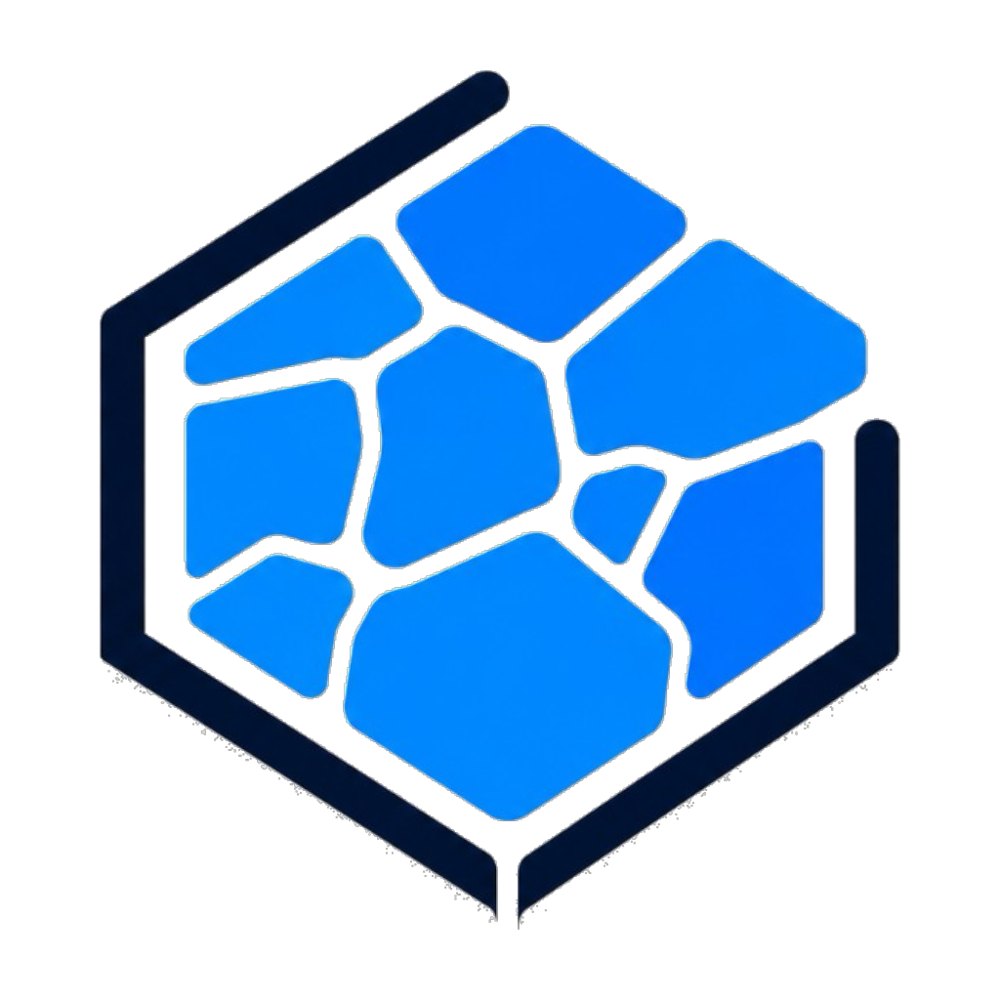
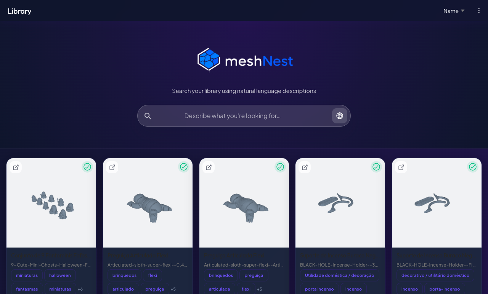
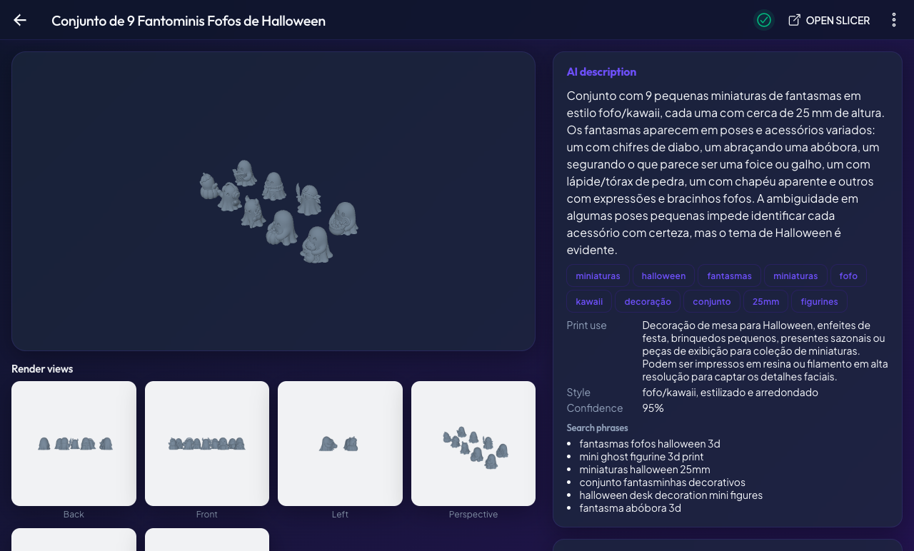
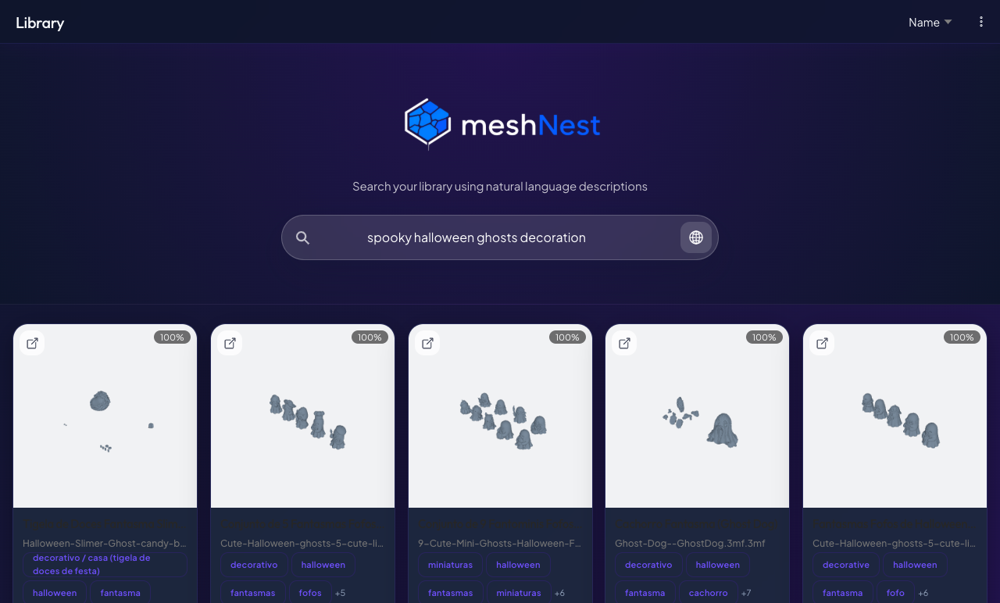
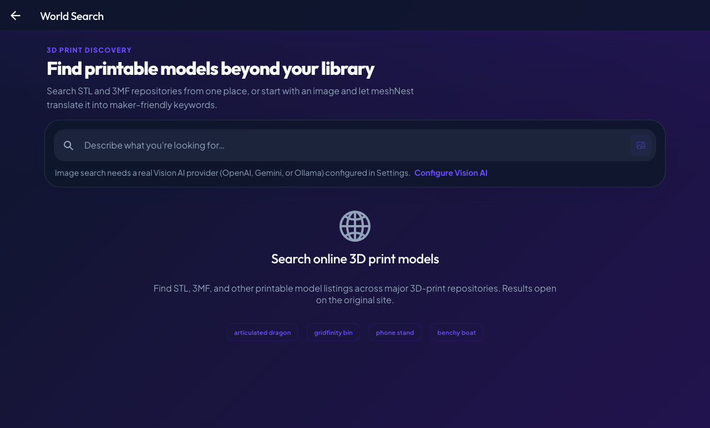
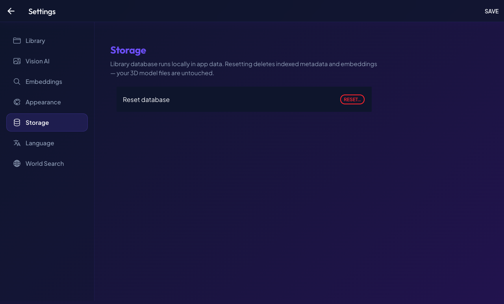

<p align="center">
  
</p>

<h1 align="center">meshNest</h1>

<p align="center">
  <strong>Semantic library for your 3D prints</strong>
</p>

<p align="center">
  meshNest indexes your <code>STL</code> and <code>3MF</code> collection with on-device AI — descriptions, tags and 3D
  previews — so you can find any model by describing it in natural language. Local-first, powered by SQLite.
</p>

<p align="center">
  <a href="https://gustavowt.github.io/meshnest/">Website</a> &middot;
  <a href="#features">Features</a> &middot;
  <a href="#getting-started">Getting Started</a> &middot;
  <a href="#ai-providers">AI Providers</a> &middot;
  <a href="#architecture">Architecture</a> &middot;
  <a href="#contributing">Contributing</a>
</p>

---

<p align="center">
  
</p>

<details>
<summary><strong>More Screenshots</strong></summary>

<br />

| Model Detail (3D preview + AI description) | Semantic Search |
|:---:|:---:|
|  |  |

| World Search | Settings |
|:---:|:---:|
|  |  |

</details>

---

## Features

- **Semantic Search** — find models by *describing* them ("spooky halloween ghosts decoration"); results ranked by embedding similarity with match confidence
- **AI Descriptions & Tags** — vision models turn renders into natural-language descriptions, searchable tags, print-use notes and confidence
- **Deterministic 3D Previews** — Three.js renders consistent multi-view thumbnails (back/front/left/perspective), including previews extracted from 3MF archives
- **World Search** — discover printable models across public 3D sites from within the app
- **Provider-Agnostic AI** — embeddings and vision via Ollama, OpenAI, Gemini, or a built-in local model; switching providers keeps your metadata
- **3MF Deep Parsing** — object names, materials and colors extracted from 3MF internals (fflate + fast-xml-parser)
- **Slicer Integration** — open any indexed model in your slicer with one click
- **Everything Local** — SQLite (WAL) + sqlite-vec keep models, metadata and vectors in app data on your machine

## Getting Started

Requires: **Node.js 22+** (and optionally [Ollama](https://ollama.com) for local AI).

```bash
git clone https://github.com/gustavowt/meshNest.git
cd meshNest
npm install
npm run build          # type-check + production build
```

Run the packaged Electron app in dev mode or download a release for macOS. On first run: pick a folder with STL/3MF files in **Settings → Library Location**, and meshNest scans, renders previews and awaits AI description runs.

## AI Providers

| Role | Providers | Notes |
| --- | --- | --- |
| Embeddings | Ollama, OpenAI, Gemini, built-in (transformers.js) | Dimensions are validated per provider before search; the index rebuilds safely on change |
| Vision (descriptions) | Ollama and other vision models, OpenAI, Gemini | Output validated with zod before persisting |

Configure in **Settings**. All AI calls run through your chosen provider — nothing leaves your machine with Ollama.

## Architecture

```
├── electron/                 # Electron main process
│   ├── main/services/        # database (SQLite + sqlite-vec), provider settings, indexing
│   ├── main/ipc/             # database, filesystem, llm, rendering, search IPC handlers
│   └── preload/              # contextBridge API (window.meshNest)
├── src/                      # Ionic + Vue 3 renderer
│   ├── views/                # Library, ModelDetail, Settings, WorldSearch
│   ├── stores/               # library, indexing, search, settings state
│   ├── services/database/    # repositories, migrations, sqlite client
│   └── i18n/                 # en / pt / es locales
└── landing/                  # website (GitHub Pages)
```

## Development

```bash
npm run dev        # vite dev server (renderer only)
npm run build      # type-check + production build
npm run test:unit  # vitest suite
npm run lint       # eslint
npm run test:e2e   # cypress
```

See [DEVELOPER.md](./DEVELOPER.md) for detailed architecture and project structure.

## Dependencies

| Dependency | Why it exists |
| --- | --- |
| `three` | Loads STL (`STLLoader`) and 3MF (`ThreeMFLoader`) files, powers the interactive 3D preview and the deterministic multi-view renderer used for AI descriptions. |
| `fflate` | Opens `.3mf` files as ZIP packages to extract internal metadata, thumbnails, and model XML. |
| `fast-xml-parser` | Parses 3MF model XML (`3D/3dmodel.model`, `[Content_Types].xml`) for object names, materials, and colors. |
| `zod` | Validates structured JSON returned by the vision LLM before it is persisted. |
| `better-sqlite3` | Local SQLite database storing model files, geometry metadata, AI descriptions, and embeddings in WAL mode with busy retry handling. Runs in the Electron main process. |
| `sqlite-vec` | Vector search extension (`vec0`) providing fast cosine KNN search over float32 embedding vectors across providers and dimensions. |
| `@duckdb/node-api` | Legacy data migration only: one-shot migrator streaming pre-existing `meshnest.duckdb` files to SQLite upon initial launch. |
| `electron` (dev) | Desktop shell providing local filesystem access, the SQLite host process, and the IPC bridge to the UI. |

## Contributing

Issues and pull requests welcome. For significant changes, open an issue first to discuss direction. Run the full gate (`lint` + `test:unit` + `build`) before submitting a PR.

## License

[AGPL v3](./LICENSE)
